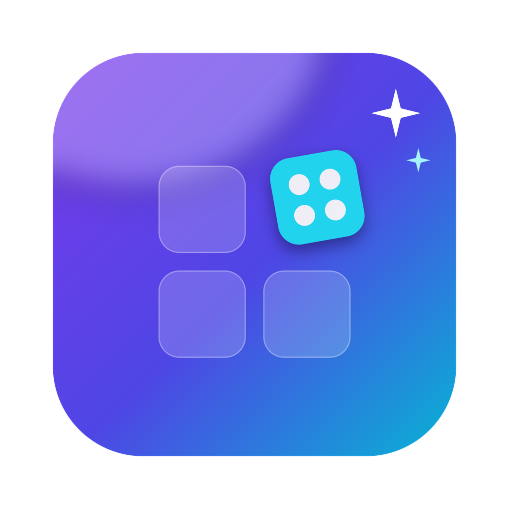
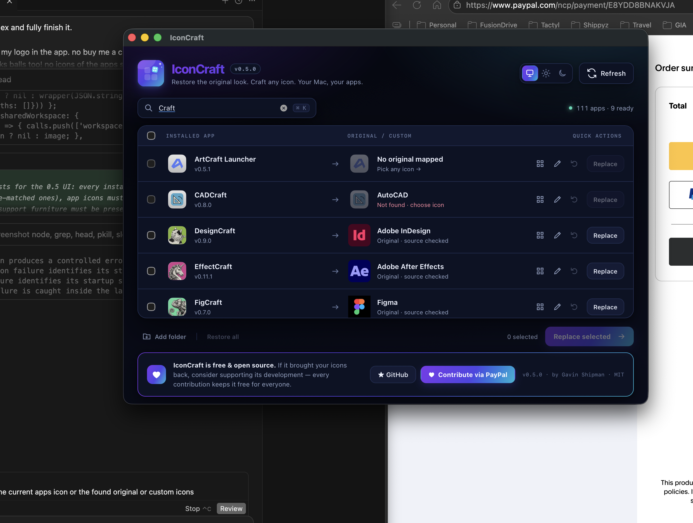
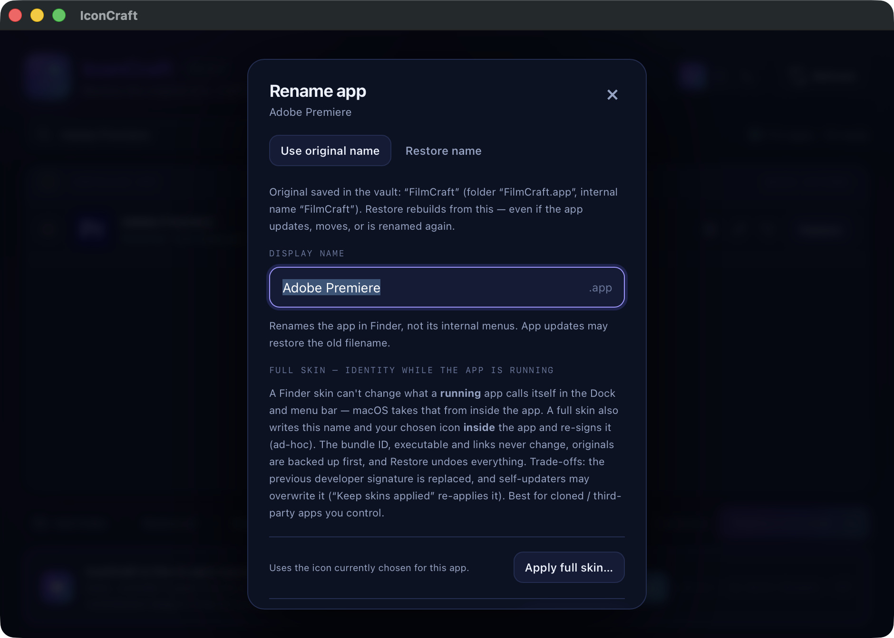

<p align="center">
  
</p>

<h1 align="center">IconCraft</h1>

<p align="center">
  <strong>Every app. Its real icon. Its real name — or any name and icon you want.</strong><br>
  A system-wide app icon &amp; name customiser for macOS. Restore genuine original
  icons and names to cloned / vibe-coded alternative apps, or give any native app
  a whole new look — safely, reversibly, in one window.
</p>

<p align="center">
  <a href="https://github.com/gshipman223/IconCraft/releases"></a>
  
  
  
  <a href="#-support-iconcraft"></a>
</p>

<p align="center">
  <a href="https://github.com/gshipman223/IconCraft/releases/latest/download/IconCraft-Mac-0.11.0-Installer.pkg"></a>
  <a href="https://github.com/gshipman223/IconCraft/releases/latest/download/IconCraft-Mac-0.11.0.zip"></a>
</p>

<p align="center">
  
</p>

<p align="center">
  
</p>

---

## What is IconCraft?

You know the situation: you (or your AI coding tool of choice) cloned or
vibe-coded an alternative to a well-known app — a Photoshop-style editor, a
CAD tool, a design app — and it sits in Finder and the Dock with a generic,
placeholder, or just plain *wrong* icon and a forgettable name.

**IconCraft fixes that, system-wide, from one window:**

- 🔍 **Finds the genuine original icon** for cloned/alternative apps from
  verified publisher sources (see [how the search works](#-how-the-original-icon-search-works)) and lets you apply it in one click.
- 🎨 **Customises any native app** — give *any* installed app any other app's
  icon, your own PNG/ICNS artwork, and a new Finder name.
- ↩️ **Restores everything** — one click per app (or Restore all) returns the
  exact original icon *and* name. Every change is journalled and
  backup-verified before anything is touched.
- 🖥️ **Every installed app is listed with its real icon** — all 100+ of them,
  searchable (⌘K), with bulk select / Replace selected.

No tabs, no accounts, no telemetry, no diagnostics maze. One screen:
**your apps → their original (or your chosen) look.**

## ✨ Features

| | |
|---|---|
| **Genuine artwork only** | Icons come from the publisher's own site/CDN, their verified App Store listing, a saved original, or the real installed app itself — never redrawn, never scraped from icon-aggregator sites. |
| **Exhaustive search** | Six layers of sources run in parallel before "Not found" is ever shown — with a plain-English report of what was checked (e.g. *"publisher site blocked (403); not on the App Store; not installed"*). |
| **Clone-friendly** | Built for ArtCraft-style and vibe-coded alternatives (`ai.storyteller.*` and friends) with verified product equivalents — Photoshop, Illustrator, Premiere Pro, Lightroom, Acrobat, After Effects, InDesign, Figma, Word, Excel, PowerPoint, Pro Tools, AutoCAD… |
| **Safe by design** | Original metadata is backed up *before* mutation, bundle identity + code signature verified, rollback on any failure, restore refuses to overwrite apps changed behind its back. |
| **Menu bar control** | IconCraft's menu bar icon toggles the background keeper, opens Setup & Permissions, jumps to App Management settings, and opens the app — while skins themselves live on disk and need no process at all. If anything removes the keeper agent, IconCraft restores it. |
| **Setup & Permissions** | The installer explains the finish-setup step, then first launch shows live Ready / Granted — tested / Blocked / Not checked statuses. App Management is proven with the same harmless bundle-writability test used before a real change — never by pretending that opening Settings is a grant. Full Disk Access, Accessibility and Screen Recording are explicitly not requested. |
| **Native icon scale** | Full-bleed publisher/App Store artwork is placed on the standard macOS icon grid (an 824px body centred in the 1024px canvas) when a Finder or full skin is applied, so skinned apps sit at the same visual size as native icons in Finder, the Dock and Launchpad. Artwork that already has proper macOS padding is never shrunk twice, and existing skins are refitted in place by the keeper. |
| **Originals Vault** | Before anything changes, your app's original name (folder + internal) and icon are saved under its stable bundle ID. Restore rebuilds from the vault — even after the app updates, moves, or is renamed again. |
| **Full skin (running identity)** | Optionally write the name + icon *inside* a cloned/third-party app (re-signed, fully backed up and reversible) so it keeps your identity in the Dock/menu bar while running. Apps that set their own Dock icon at launch from artwork embedded in the executable (e.g. Rust/eframe clones) get that embedded copy swapped in place too — same byte length, originals backed up — and IconCraft says so plainly when an app's running icon can't be replaced safely. Bundle ID and links never change. |
| **Skins that stick** | Third-party apps/updaters love reverting Finder icons and names on launch. Turn on **Keep skins applied** and a tiny background agent re-applies yours automatically — nothing inside any app is ever edited. |
| **Rename apps** | Rename in Finder (the outer `.app`, exactly like Finder does) with *Use original name* / *Restore name*. Running, protected, or colliding apps are refused. |
| **Fast** | Cached inventory paints instantly; scans, thumbnails and original-icon checks continue in the background. Content-addressed previews, single-flight native calls. |
| **Native & private** | Go backend on an authenticated loopback port + a native AppKit/WebKit window. Nothing leaves your Mac except publisher icon lookups. No analytics. Ever. |
| **Looks the part** | Modern dark-first UI with System / Light / Dark, following your Mac live. |

## 📦 Install

**Requires macOS 12.3+ (Apple Silicon or Intel). No developer account, Xcode,
Homebrew or VM needed.**

**Option A — installer package (one click):** download
[`IconCraft-Mac-0.11.0-Installer.pkg`](https://github.com/gshipman223/IconCraft/releases/latest/download/IconCraft-Mac-0.11.0-Installer.pkg)
and open it; its Welcome screen explains the one finish-setup step, it installs IconCraft to `/Applications`, and its Conclusion screen tells you to open IconCraft and complete Setup & Permissions.

**Option B — ZIP:** download `IconCraft-Mac-0.11.0.zip` from the
[latest release](https://github.com/gshipman223/IconCraft/releases/latest),
extract it, and run **Install IconCraft.command** next to `IconCraft.app`.
The script verifies checksums, preserves your settings/backups, applies
a local ad-hoc signature, and only swaps in the new app after checking it runs.

Then open IconCraft and complete **Finish setup**:

1. Choose **Run checks**.
2. If App Management is blocked, use the supplied button to open System Settings, switch IconCraft on, return, and choose **Check again**. A green **Granted — tested** result means IconCraft proved the needed write access on one installed app.
3. Choose whether the optional background helper stays on.
4. Choose **Finish setup**. You can reopen this screen at any time from **Setup & permissions** or the menu bar icon — and you should recheck after an IconCraft update, because macOS may treat a newly signed local copy as new.

> The app is ad-hoc signed, not Developer-ID signed/notarised (no paid Apple
> certificate — this is a free open-source project). If macOS blocks a
> downloaded copy, use **System Settings → Privacy & Security → Open Anyway**
> for that item. Don't disable Gatekeeper globally.

## 🚀 Usage

1. **Pick an app** from the list (search with ⌘K).
2. If a genuine original was found, hit **Replace** — or select many and
   **Replace selected**.
3. Want a different look? Click the **grid icon** to borrow any installed
   app's icon, or *Choose image file…* for your own PNG/ICNS.
4. Click the **pencil** to rename the app, use its original name, or restore it.
5. Changed your mind? **Restore** (per app) or **Restore all** puts back the
   exact original icon and name.

## 🔎 How the original-icon search works

"Not found" should mean *we actually looked everywhere*. For each mapped
product, these run in parallel:

1. **Publisher product pages** (US + regional + help/download pages), including
   icon URLs embedded in page JSON on JavaScript-heavy sites.
2. **Publisher CDN icon paths** (e.g. Adobe's product-icon CDN).
3. **Verified App Store listing** by exact track ID (US + AU regions).
4. **Verified App Store search** — seller must be the publisher, the track
   name must equal the product, *and* the bundle ID must be known: knockoffs
   like "CAD Plus" are rejected.
5. **Saved original** from a previous successful check (works offline).
6. **The genuine installed app itself** — exact bundle ID, year-suffixed
   variants (`AutoCAD2025.app`), or exact product name.

Only genuine artwork is ever applied. Vendor artwork remains its owners'
property; IconCraft's code is MIT (see [License](#-license)).

## 🛡️ Safety model

- Backup-before-write journal for every change; verify-after-write; automatic
  rollback on failure; "rollback-required" state is surfaced, never hidden.
- Code signatures verified before *and* after a change using checks that
  understand Finder custom icons (a strict `codesign` check would reject the
  very icon data being set — ask us how we know).
- Symlinked bundles, protected system paths, invalid/active-SVG artwork,
  oversized responses and non-publisher URL redirects are all rejected.
- Only apps you select are modified. No global icon-cache purges, no binary
  patching, no security-setting changes.

## 🏗️ Building from source

```sh
bash build-current.sh        # fmt, JS checks, go test (+race, vet), universal build
python3 scripts/build_macos.py
./build/IconCraft.app/Contents/MacOS/IconCraft --self-test   # 27 native checks, disposable fixtures only
python3 scripts/package_v05.py                               # release ZIPs into build/packages/
```

**Stack:** Go (standard library only) backend · authenticated loopback HTTP
service · native AppKit/WebKit window via embedded JXA · vanilla
HTML/CSS/JavaScript UI. Tests: Go unit/race suites, Node bridge/UI contract
tests, and macOS-native fixture tests run via `--self-test`.

**Repo layout**

```
cmd/iconcraft/     entry point, launch-failure reporting
internal/core/     app discovery, journalled apply/restore, rename, cache
internal/originals/ verified publisher/App Store icon resolver
internal/native/   AppKit/WebKit bridge (JXA) + native diagnostics
internal/server/   loopback HTTP API, thumbnails, embedded UI
assets/            logo.svg (source) · icon.icns · logo-1024.png
scripts/           build, packaging, installer, logo generator
docs/              changelogs, acceptance + validation evidence
```

## 🗺️ Roadmap

- [ ] Developer ID signing + notarisation (needs a paid Apple Developer account — [support the project](#-support-iconcraft) to help make it happen)
- [ ] More verified product mappings (open an issue with evidence)
- [ ] Dock/Finder refresh hints after applying icons
- [ ] Localisation

## 🤝 Contributing

PRs and verified mapping data are very welcome — see
[CONTRIBUTING.md](CONTRIBUTING.md) and our [Code of Conduct](CODE_OF_CONDUCT.md).
Please don't submit third-party artwork; mappings must distinguish *verified*
equivalents from suggestions. Found a bug? Use the
[issue templates](https://github.com/gshipman223/IconCraft/issues/new/choose).

## ❤️ Support IconCraft

IconCraft is **free and open source**. If it brought your icons back,
please consider supporting its development — every contribution keeps it
free for everyone (and funds the Apple Developer account for signed,
notarised releases):

<p align="center">
  <a href="https://www.paypal.com/ncp/payment/E8YDD8BNAKVJA"></a>
</p>

The same contribution bar lives at the bottom of the app window.
`v0.11.0 · by Gavin Shipman · MIT`

## 📄 License

MIT — Copyright © 2026 Gavin Shipman and IconCraft contributors.
Independent of ArtCraft, Adobe, Microsoft, Figma, Avid and Autodesk.
Genuine vendor artwork fetched by the app is **not** relicensed by this
repository and remains subject to its owners' terms.
